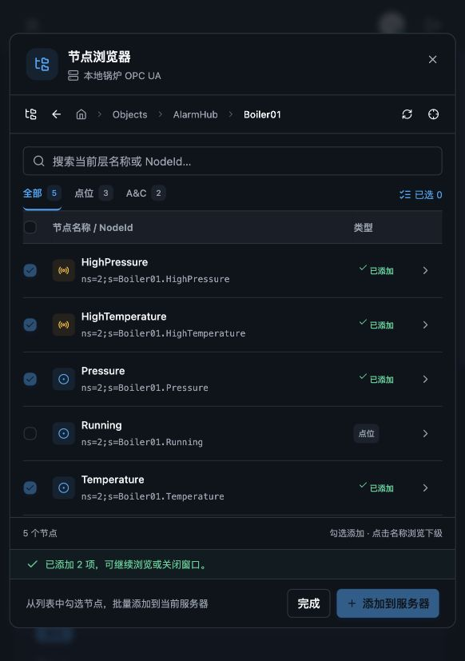

# AlarmHub OPC UA 插件示例

仿照 AlarmHub 的告警分类、点位规则、A&C 规则和告警记录，验证通用 OPC UA 插件。
主题沿用 Hub 的 Arco，启用 `plugins=["opcua", "site_logger"]`。
`app/models/` 中没有 OPC UA 模型或 Browse 页面覆盖，三个模型与浏览器均由插件生成。

## 启动

从仓库根目录安装开发环境后，在示例目录操作：

```bash
uv sync --group dev
cd examples/alarmhub
../../.venv/bin/site sync
npm --prefix generated/frontend install
../../.venv/bin/python scripts/run_demo.py
```

已经全局安装 OneSite 的环境也可使用 `site sync --install` 安装生成应用的依赖，
再用同一 Python 环境运行 `scripts/run_demo.py`。

- 页面：<http://127.0.0.1:15273>
- API：<http://127.0.0.1:18280/docs>
- OPC UA：`opc.tcp://127.0.0.1:14860/alarmhub/`
- 本地演示账户：`admin@example.com` / `admin`（developer 角色）。

`run_demo.py` 同时启动模拟 OPC UA 服务、后端和前端；Ctrl+C 停止全部进程。
该脚本临时设置生成前端的 `public/config.js`，指向本示例后端端口，退出时恢复。
模拟服务及 HTTP 服务仅监听本机。首次启动自动添加演示数据；重复启动不重复插入。

## 手工验证 Browse

1. 打开“OPCUA 服务”→“本地锅炉 OPC UA”的详情。
2. 点击“浏览节点”，进入 `Objects → AlarmHub → Boiler01`。
3. 能看到 Temperature、Pressure、Running 三个变量，以及 HighTemperature、
   HighPressure 两个自定义 A&C 条件。
4. Temperature 和 HighTemperature 已由演示数据配置，显示“已添加”。
5. 勾选 Pressure、HighPressure，点击“添加到服务器”，应提示“已添加 2 项”。
6. 关闭窗口，分别切换“OPCUA 点位”和“OPCUA A&C”，新增记录立即可见。
7. 再次打开 Browse，新添加的两项也显示“已添加”，不可重复勾选。

也可通过 NodeId 定位直接进入：`nsu=urn:onesite:alarmhub:demo;s=Boiler01`。



## 自动联调测试

```bash
../../.venv/bin/python scripts/smoke_test.py
npm --prefix generated/frontend run build
```

`smoke_test.py` 启动真实的临时 OPC UA 服务，使用临时 SQLite 数据库，覆盖：

- 生成应用登录、Server 初始化、Root 和稳定命名空间地址浏览。
- 三个变量和两个自定义 ConditionType 子类型的识别。
- 点位和 A&C 添加、重复点位返回 409。
- 告警规则对插件模型的外键引用，以及响应中的关联名称。
- developer 可写、admin 可浏览但不可写、user 不可浏览或写入。
- 错误规则、无效 NodeId、连接失败的状态码和错误信息。

测试不会修改正在展示的演示数据库。2026-10-28 已通过自动联调、前端生产构建，
以及上述 Browse 批量添加与两个关联列表刷新的页面实测。

## 示例边界

模拟服务定时改变温度值，并公开可供 Browse 发现的条件对象；它不触发真实 A&C
事件。告警记录是明确标注的静态演示数据，不自动评估规则、不拨打电话或发送消息。
完整持续采集、事件处理和告警通知仍属于后续项目运行服务。
